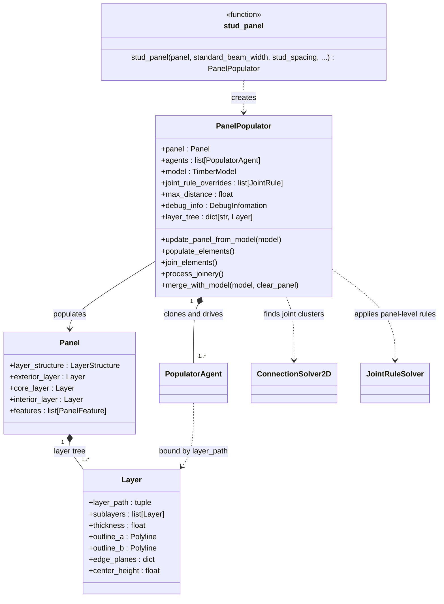
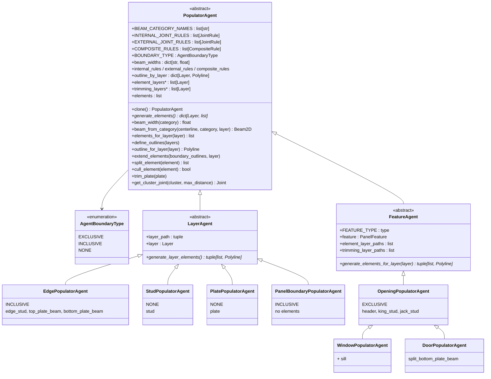
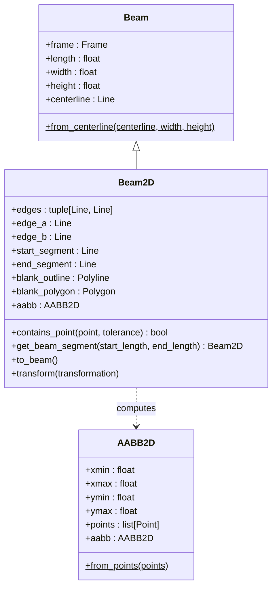
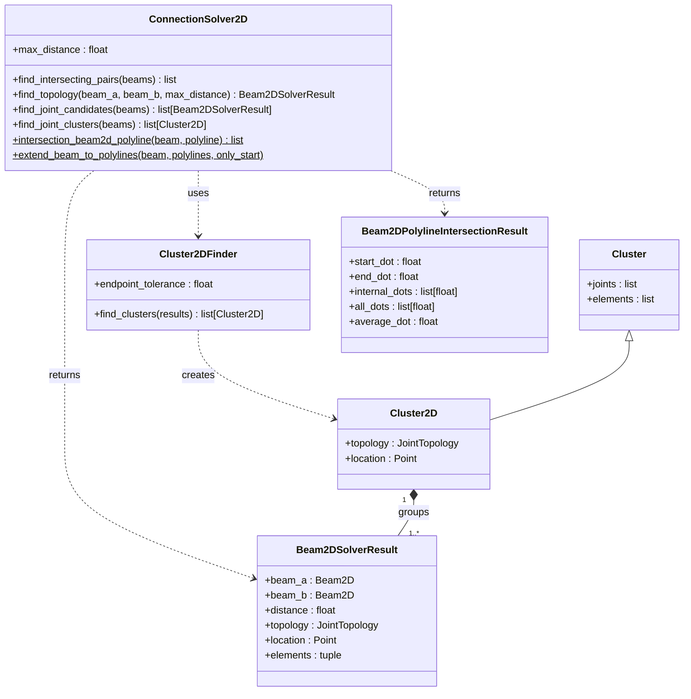

# Class Diagrams

This section provides visual representations of the class hierarchies and relationships in the `timber_design` package.

[TOC]

## Populators Subsystem

### Orchestration

`PanelPopulator` is the only writer to its internal model.  It extracts the
panel's layer tree into that model, drives the agents through the pipeline, and
merges the result back under the original panel.  Agents never touch the model:
they return elements, and later find their own elements again through the
`attributes["agent"]` tag on each one (stripped again by `merge_with_model`).

`populate_elements()` runs: build populator model → repoint agents to its
layers → **generate** → **define outlines** → **extend** → **split** →
**cull**.  `join_elements()` resolves each cluster with, in order: the owning
agents' rules on the whole cluster, the populator's `joint_rule_overrides` on
the whole cluster, then both again pair by pair.

---

### Populator Agents

Notes:

- **Construction state only.**  An agent's `__data__` is its constructor
  arguments, so `clone()` (`type(agent)(**agent.__data__)`) produces a fresh
  agent that shares only the bound feature.  `PanelPopulator` clones every agent
  it receives.
- **Layers by path.**  Agents store layer paths and are rebound to the live
  layers of the populator model by `repoint_to_layer_tree` at the start of
  every `populate_elements()`.
- **Boundaries.**  `BOUNDARY_TYPE` decides what `cull_element` removes after
  splitting: segments outside an `INCLUSIVE` outline, inside an `EXCLUSIVE`
  one, or nothing.  An agent never trims its own elements.
- **Opening dispatch.**  Binding an `Opening` to a plain
  `OpeningPopulatorAgent` swaps its class to `WindowPopulatorAgent` or
  `DoorPopulatorAgent` according to `opening.opening_type`.
- **Rule overrides.**  `*_joint_overrides` replace a default rule with the same
  topology and categories, and are appended otherwise.
  `EdgePopulatorAgent.get_cluster_joint` computes joints between two of its own
  beams geometrically when either panel edge is sloped.

---

### 2D Geometry

`Beam2D` extends compas_timber's `Beam` with a lazily cached 2D blank outline
used for all intersection and topology detection.  `AABB2D` is a lightweight 2D
bounding box that avoids the `ZeroDivisionError` that `compas.geometry.Box`
raises on flat geometry.

`to_beam()` swaps the instance's class to `Beam` in place, so joints and model
references stay valid when `merge_with_model` hands the elements back.

---

### Connection Solver

`ConnectionSolver2D` finds beam pairs whose AABBs overlap, classifies each pair
with `find_topology` (blank-corner containment plus edge crossings), and groups
the resulting candidates into clusters with `Cluster2DFinder`.  It also provides
the static helpers the agents use for splitting and extending beams.

`find_topology` returns `None` for a beam swallowed entirely by another (a
degenerate stub left over from splitting) and reports face-to-face overlaps as
`TOPO_UNKNOWN` until `TOPO_FACE_FACE` is supported.
