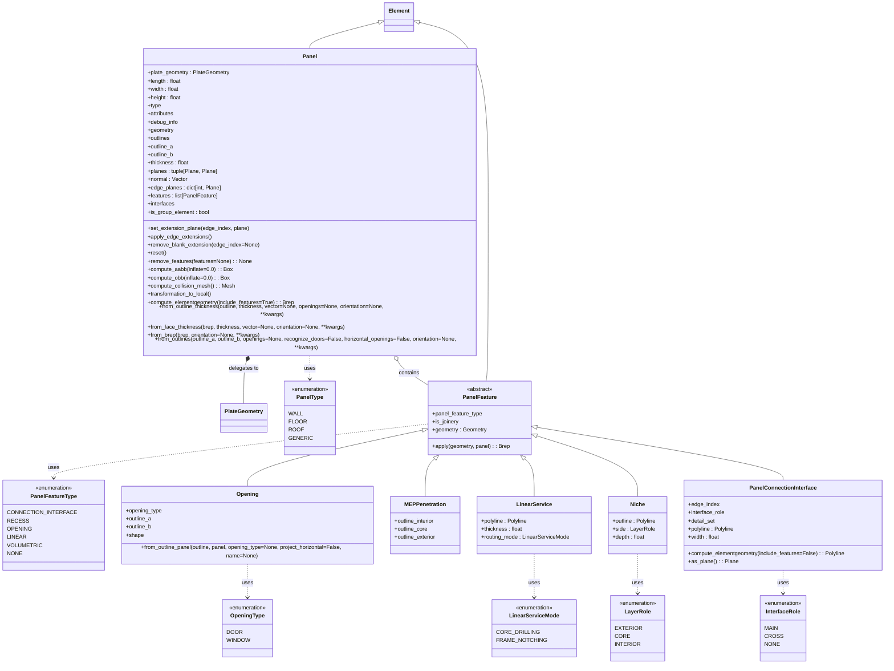
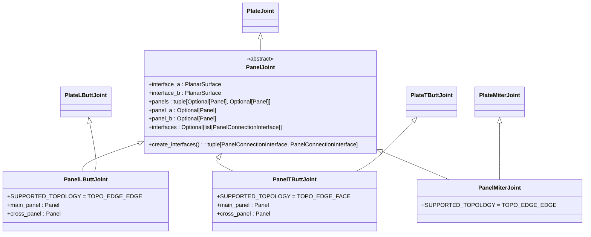
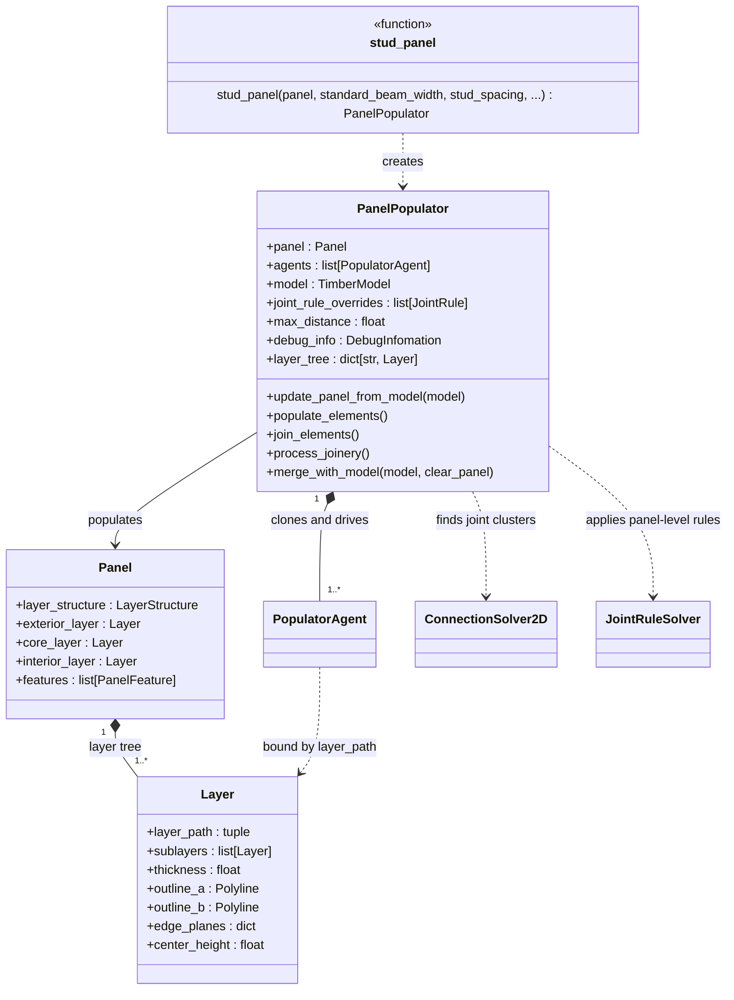
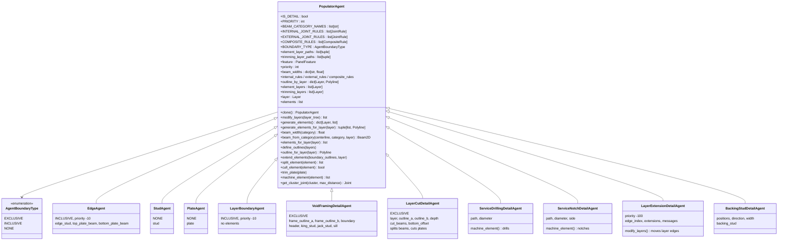
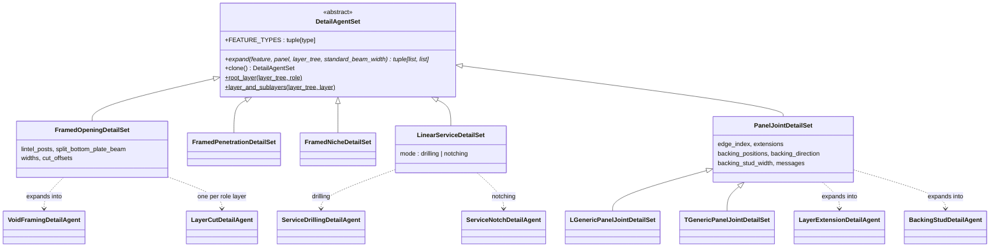
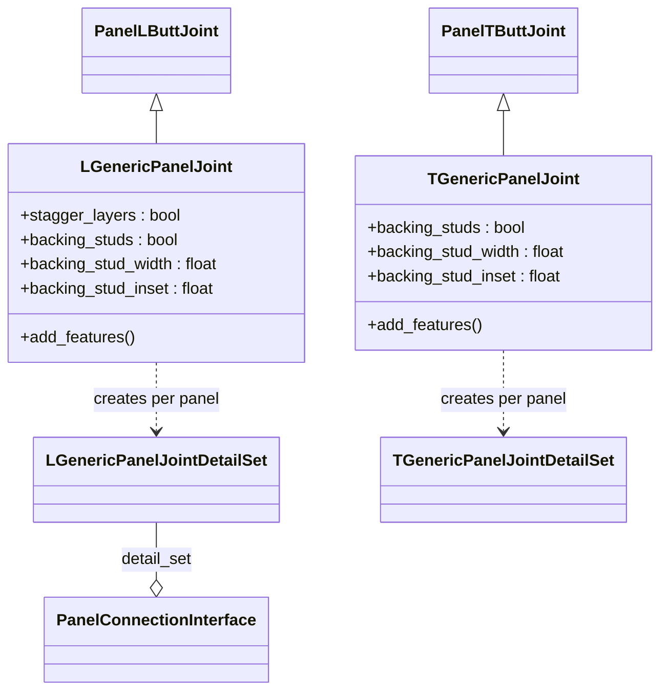
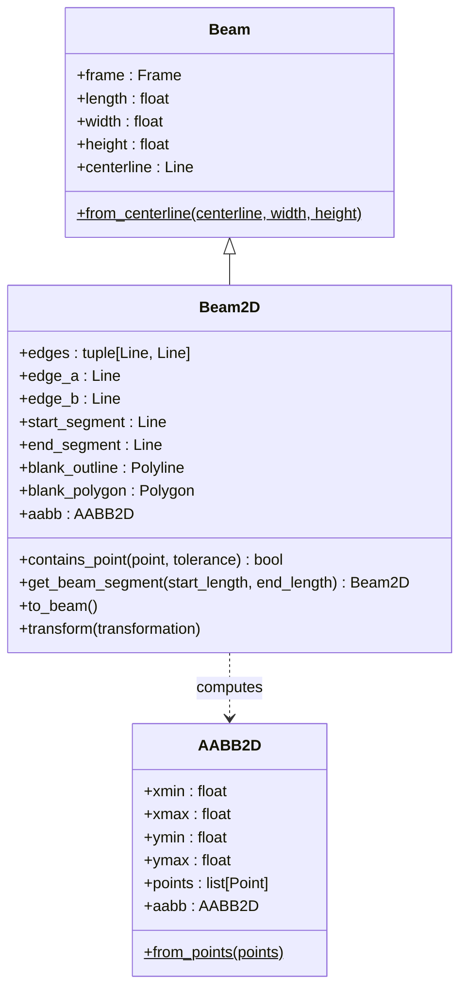
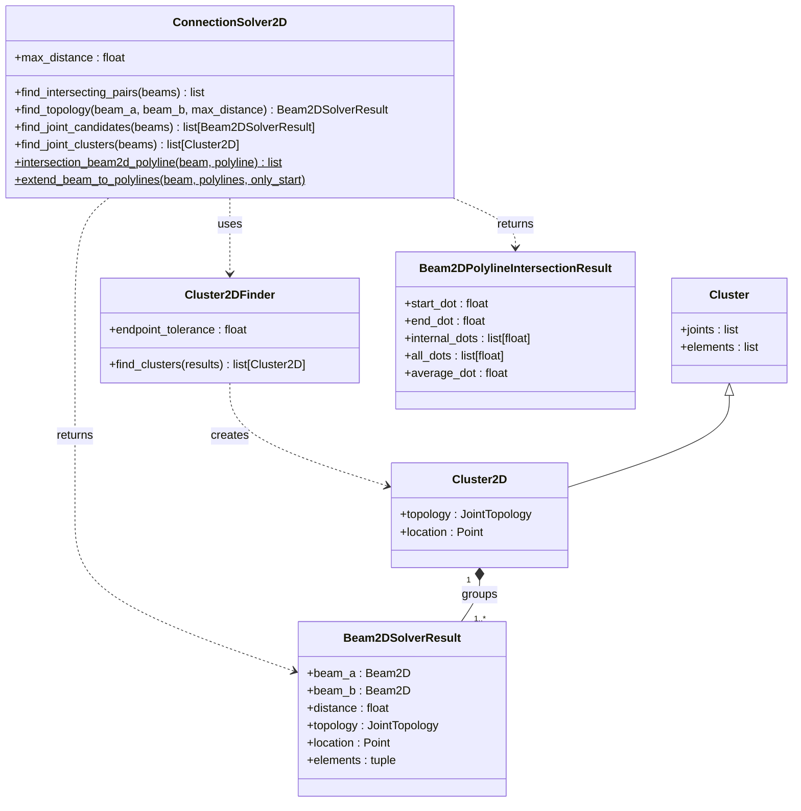

# Class Diagrams

This section provides visual representations of the class hierarchies and relationships in the `timber_design` distribution.

[TOC]

## compas_arch

`compas_arch` extends COMPAS Timber; classes from `compas_timber` and `compas_model` that appear here
(`Element`, `PlateGeometry`, the plate joints) are documented in the
[COMPAS Timber class diagrams](https://gramaziokohler.github.io/compas_timber/latest/contribution/class_diagrams/).

### Elements

### Connections

---

## Populators Subsystem

### Orchestration

`PanelPopulator` is the only writer to its internal model.  It extracts the
panel's layer tree into that model, drives the agents through the pipeline, and
merges the result back under the original panel.  Agents never touch the model:
they return elements, and later find their own elements again through the
`attributes["agent"]` tag on each one (stripped again by `merge_with_model`).

`populate_elements()` runs: bind each feature's detail set (its own
`detail_set`, else `default_detail_sets[type]`) → build populator model →
expand the sets into detail agents → sort all agents by `priority` (stable) →
repoint agents to its layers → **modify layers** (agents set extension planes,
e.g. connection details) → **generate** → **define outlines** → **extend** →
**split** → **cull** → **machine**.  `join_elements()` resolves each cluster with, in order: the owning
agents' rules on the whole cluster, the populator's `joint_rule_overrides` on
the whole cluster, then both again pair by pair.

---

### Populator Agents

One base class; one module per agent.  Panel-wide agents are given to the
populator, detail agents (`IS_DETAIL = True`) are created by detail sets.

Notes:

- **Construction state only.**  An agent's `__data__` is its constructor
  arguments, so `clone()` (`type(agent)(**agent.__data__)`) produces a fresh
  agent that shares only the bound feature.  `PanelPopulator` clones every agent
  it receives.
- **Layers by path.**  Agents store layer paths (`layer=` sets both lists) and
  are rebound to the live layers of the populator model by
  `repoint_to_layer_tree` at the start of every `populate_elements()`.
- **Boundaries.**  `BOUNDARY_TYPE` decides what `cull_element` removes after
  splitting: segments outside an `INCLUSIVE` outline, inside an `EXCLUSIVE`
  one, or nothing.  An agent never trims its own elements.
- **Detail agents take explicit inputs.**  They never derive anything from the
  feature (it is only a tag); a detail set derives their frames, boundaries,
  cuts, planes and positions.  `PanelPopulator(agents=...)` skips detail
  agents and reports them.
- **Priority.**  Agents run in order of `priority` (class `PRIORITY` unless
  given), stable, so equal priorities keep their order; detail agents come
  after the panel-wide agents they tie with.  Layer extensions (-100) run
  before anything is generated; the populator reports two agents setting the
  same layer edge (the later one wins).
- **Rule overrides.**  `*_joint_overrides` replace a default rule with the same
  topology and categories, and are appended otherwise.
  `EdgeAgent.get_cluster_joint` computes joints between two of its own beams
  geometrically when either panel edge is sloped.

---

### Detail Sets

A feature states design intent; exactly one detail set decides how it is
built (the feature's `detail_set`, else the populator's default for its type)
and expands into detail agents.  One module per set in
`timber_design_populator/detail_sets/`; the built-in sets are examples and
defaults, not the only options.

### Panel Joints with Connection Details

A detail joint does all cross-panel calculation in `add_features()`, with both
panels in view, and sets each panel's half (in that panel's local frame) as the
`detail_set` of the panel's `PanelConnectionInterface`.  One module per joint
in `timber_design_populator/panel_joints/`.

---

### 2D Geometry

`Beam2D` extends compas_timber's `Beam` with a lazily cached 2D blank outline
used for all intersection and topology detection.  `AABB2D` is a lightweight 2D
bounding box that avoids the `ZeroDivisionError` that `compas.geometry.Box`
raises on flat geometry.

`to_beam()` swaps the instance's class to `Beam` in place, so joints and model
references stay valid when `merge_with_model` hands the elements back.

---

### Connection Solver

`ConnectionSolver2D` finds beam pairs whose AABBs overlap, classifies each pair
with `find_topology` (blank-corner containment plus edge crossings), and groups
the resulting candidates into clusters with `Cluster2DFinder`.  It also provides
the static helpers the agents use for splitting and extending beams.

`find_topology` returns `None` for a beam swallowed entirely by another (a
degenerate stub left over from splitting) and reports face-to-face overlaps as
`TOPO_UNKNOWN` until `TOPO_FACE_FACE` is supported.
