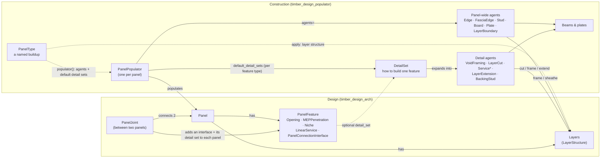
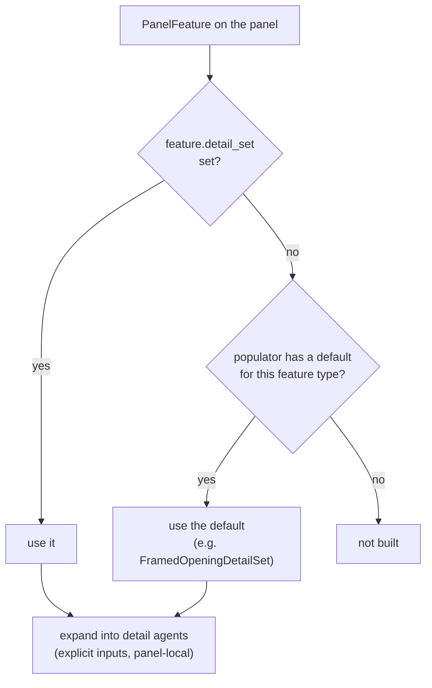
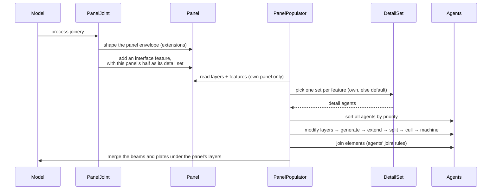
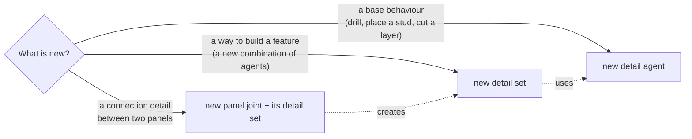

# Panels, Joints, Features and the Populator at a Glance

Four diagrams of how the pieces fit together.  For the details, see
[Populating Panels](populating_panels.md); for the full class diagrams, see
[Class Diagrams](../contribution/class_diagrams.md).

## Who owns what

A **panel** is a design element: an outline, a thickness and a stack of
**layers**, plus **panel features** that state design intent (an opening here, a
niche there).  A **panel joint** connects two panels and gives each one a
**connection interface**, which is just another feature.  How a feature is
*built* is decided by a **detail set**.  The **populator** frames one panel with
**agents**: panel-wide ones that you give it, and detail agents that the detail
sets create.

## One rule: every feature is built by exactly one detail set

The feature's own `detail_set` if it has one, else the populator's default for
the feature's type.  Panel joints always set their interfaces' detail sets, so
connection details need nothing on the populator.

## From model to framing

The joint sees both panels; each populator sees only its own.  All cross-panel
calculation therefore happens in the joint, which hands each panel its half as a
ready detail set.

## Three ways to extend

